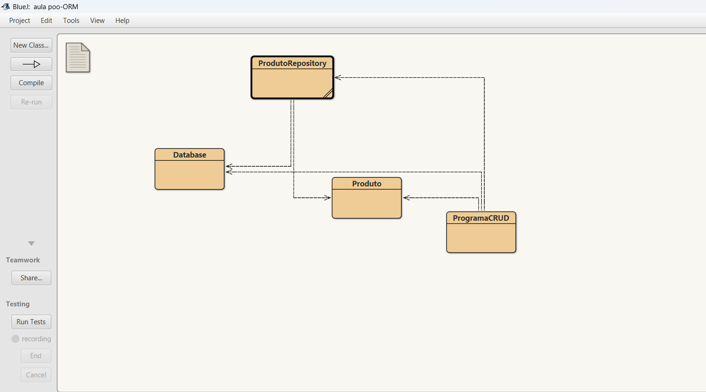
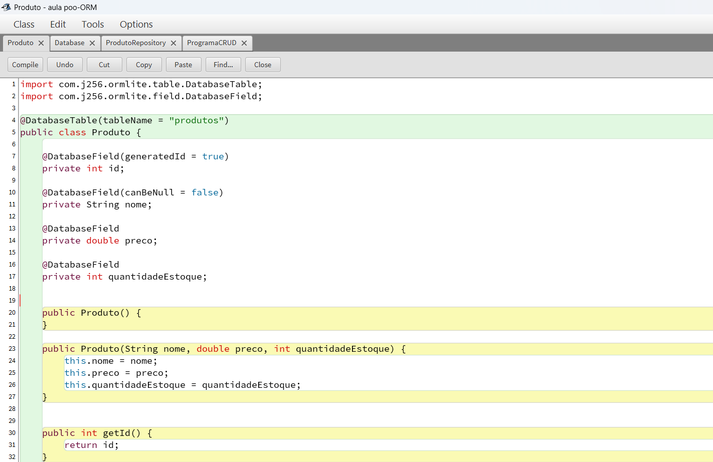
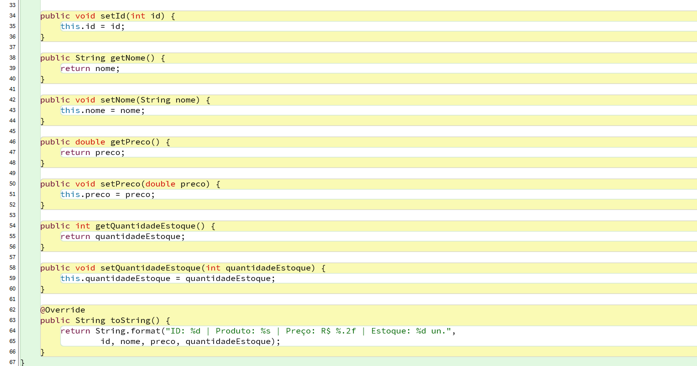
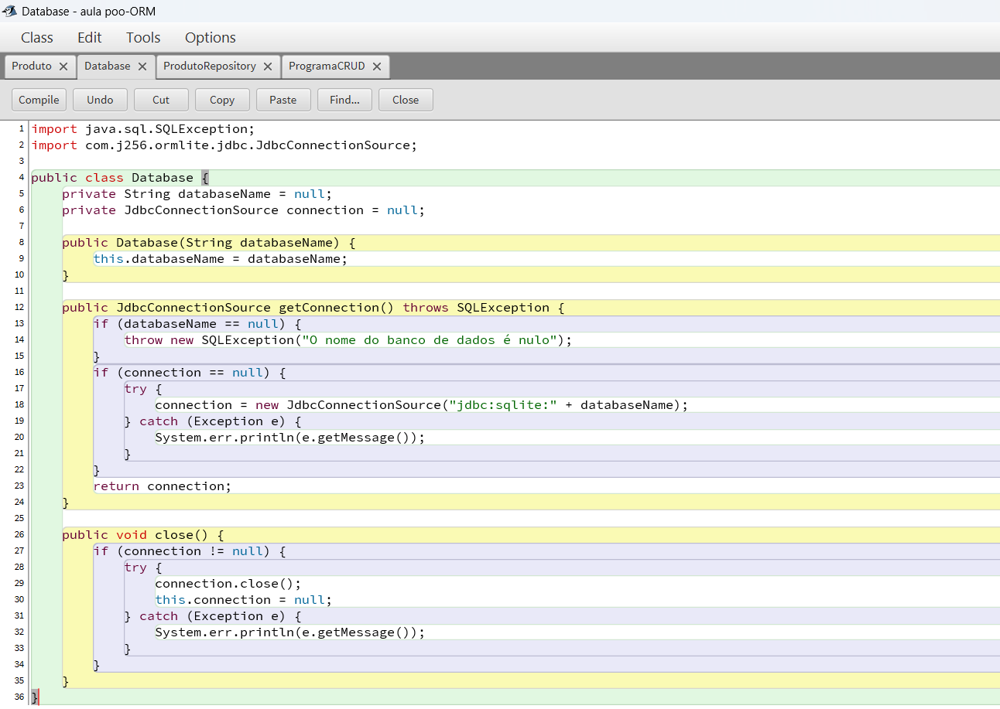
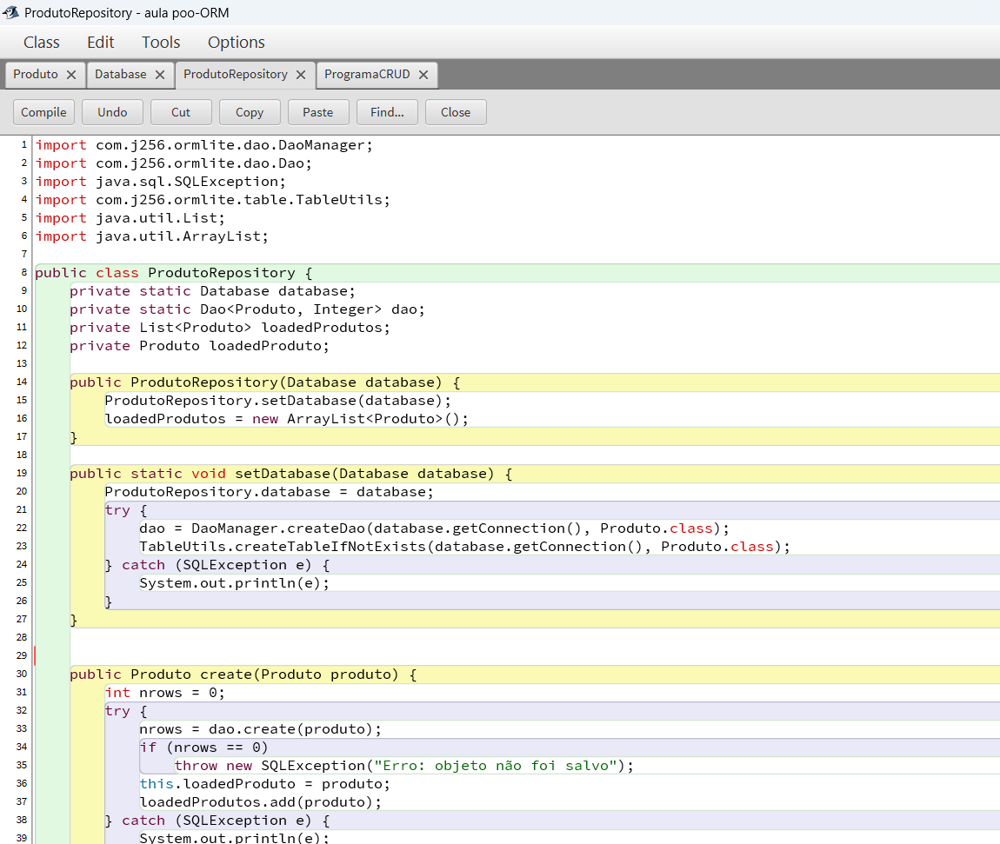
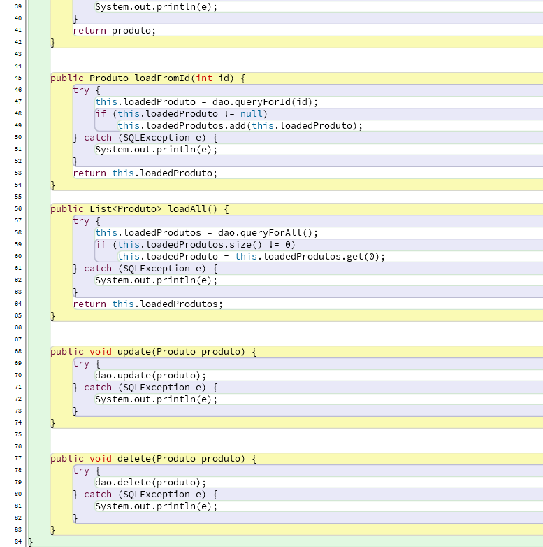
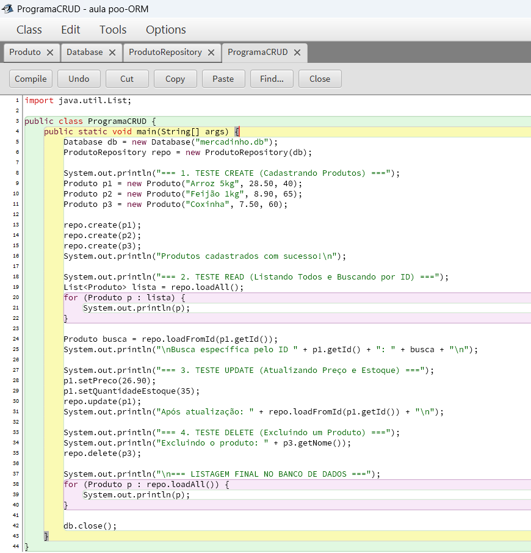
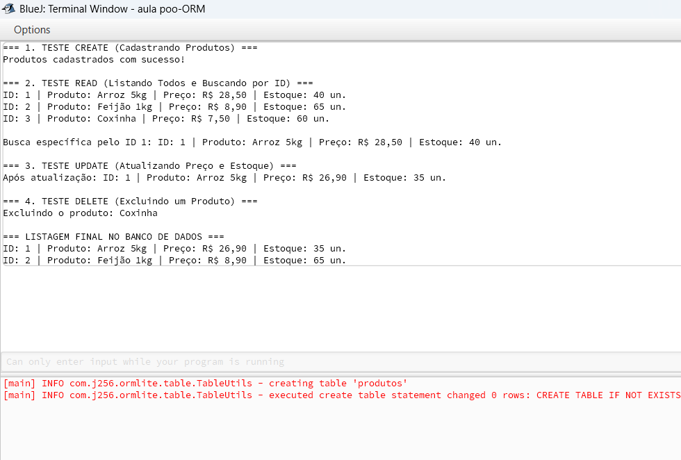
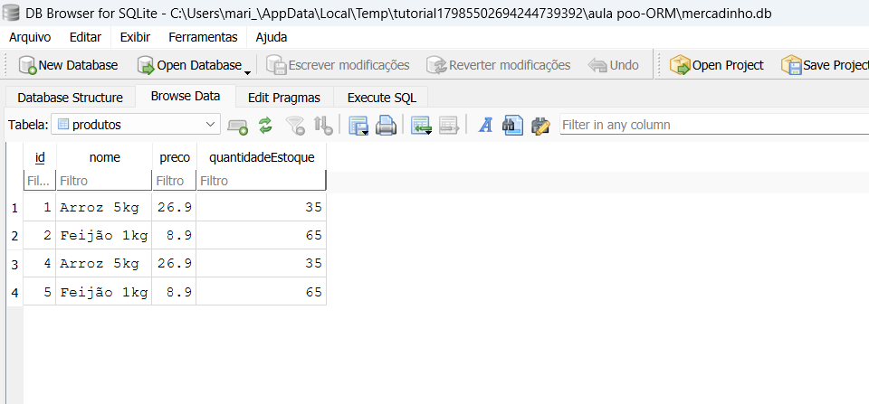

*Nome: Pedro Henrique Machado Benício*
*Matrícula: 202600677*

# Atividade Prática – Persistência de Dados com ORM e CRUD

Dando continuidade ao meu projeto de controle de estoque de um mercado/mercearia, selecionei a classe `Produto` para realizar o Mapeamento Objeto-Relacional (ORM) utilizando o framework ORMLite e o banco de dados SQLite, aplicando o padrão de projeto *Repository* visto no tutorial.

Para que o ORMLite pudesse gerenciar a criação de tabelas e consultas no banco de dados, adaptei a classe `Produto` para uma classe concreta, adicionei um atributo identificador (`id`) autogerado como chave primária, um construtor vazio (exigido pelo ORMLite) e os métodos *getters* e *setters* necessários para manipulação e atualização dos registros.

# 1) Mapeamento da Classe de Modelo (Produto)

Utilizei a anotação `@DatabaseTable(tableName = "produtos")` para vincular a classe à tabela correspondente no banco de dados e `@DatabaseField` para mapear os atributos `id`, `nome`, `preco` e `quantidadeEstoque` como colunas da tabela.

## Classe Produto

```java
import com.j256.ormlite.table.DatabaseTable;
import com.j256.ormlite.field.DatabaseField;

@DatabaseTable(tableName = "produtos")
public class Produto {
    
    @DatabaseField(generatedId = true)
    private int id;
    
    @DatabaseField(canBeNull = false)
    private String nome;
    
    @DatabaseField
    private double preco;
    
    @DatabaseField
    private int quantidadeEstoque;

    public Produto() {
    }

    public Produto(String nome, double preco, int quantidadeEstoque) {
        this.nome = nome;
        this.preco = preco;
        this.quantidadeEstoque = quantidadeEstoque;
    }

    public int getId() {
        return id;
    }

    public void setId(int id) {
        this.id = id;
    }

    public String getNome() {
        return nome;
    }

    public void setNome(String nome) {
        this.nome = nome;
    }

    public double getPreco() {
        return preco;
    }

    public void setPreco(double preco) {
        this.preco = preco;
    }

    public int getQuantidadeEstoque() {
        return quantidadeEstoque;
    }

    public void setQuantidadeEstoque(int quantidadeEstoque) {
        this.quantidadeEstoque = quantidadeEstoque;
    }

    @Override
    public String toString() {
        return String.format("ID: %d | Produto: %s | Preço: R$ %.2f | Estoque: %d un.", 
                id, nome, preco, quantidadeEstoque);
    }
}
```

# 2) Conexão com o Banco e Implementação do Padrão Repository (CRUD)

Para estabelecer a comunicação com o banco de dados relacional SQLite (`mercadinho.db`), utilizei a classe `Database` em conjunto com a classe `ProdutoRepository`. Na classe `ProdutoRepository`, implementei as quatro operações fundamentais do CRUD utilizando o DAO (*Data Access Object*) fornecido pelo ORMLite:

* **Create (`create`):** Insere um novo produto na tabela `produtos`.
* **Read (`loadFromId` e `loadAll`):** Realiza a consulta de um produto específico pelo seu `id` ou retorna uma listagem completa com todos os produtos cadastrados no estoque.
* **Update (`update`):** Atualiza os dados (como preço ou quantidade em estoque) de um produto já existente no banco.
* **Delete (`delete`):** Remove o registro de um produto do banco de dados.

## Classe ProdutoRepository

```java
import com.j256.ormlite.dao.DaoManager;
import com.j256.ormlite.dao.Dao;
import java.sql.SQLException;
import com.j256.ormlite.table.TableUtils;
import java.util.List;
import java.util.ArrayList;

public class ProdutoRepository {
    private static Database database;
    private static Dao<Produto, Integer> dao;
    private List<Produto> loadedProdutos;
    private Produto loadedProduto;

    public ProdutoRepository(Database database) {
        ProdutoRepository.setDatabase(database);
        loadedProdutos = new ArrayList<Produto>();
    }

    public static void setDatabase(Database database) {
        ProdutoRepository.database = database;
        try {
            dao = DaoManager.createDao(database.getConnection(), Produto.class);
            TableUtils.createTableIfNotExists(database.getConnection(), Produto.class);
        } catch (SQLException e) {
            System.out.println(e);
        }
    }

    public Produto create(Produto produto) {
        int nrows = 0;
        try {
            nrows = dao.create(produto);
            if (nrows == 0)
                throw new SQLException("Erro: objeto não foi salvo");
            this.loadedProduto = produto;
            loadedProdutos.add(produto);
        } catch (SQLException e) {
            System.out.println(e);
        }
        return produto;
    }

    public Produto loadFromId(int id) {
        try {
            this.loadedProduto = dao.queryForId(id);
            if (this.loadedProduto != null)
                this.loadedProdutos.add(this.loadedProduto);
        } catch (SQLException e) {
            System.out.println(e);
        }
        return this.loadedProduto;
    }

    public List<Produto> loadAll() {
        try {
            this.loadedProdutos = dao.queryForAll();
            if (this.loadedProdutos.size() != 0)
                this.loadedProduto = this.loadedProdutos.get(0);
        } catch (SQLException e) {
            System.out.println(e);
        }
        return this.loadedProdutos;
    }

    public void update(Produto produto) {
        try {
            dao.update(produto);
        } catch (SQLException e) {
            System.out.println(e);
        }
    }

    public void delete(Produto produto) {
        try {
            dao.delete(produto);
        } catch (SQLException e) {
            System.out.println(e);
        }
    }
}
```

# 3) Testes das Operações CRUD e Evidências de Persistência

Para demonstrar o funcionamento das quatro operações, criei a classe `ProgramaCRUD` e realizei os testes práticos no BlueJ.

1. **Operação Create:** Foram instanciados e persistidos três itens no estoque: "Arroz 5kg" (R$ 28,50 - 40 un.), "Feijão 1kg" (R$ 8,90 - 65 un.) e "Coxinha" (R$ 7,50 - 60 un.).
2. **Operação Read:** Utilizei o método `loadAll()` para listar todos os itens cadastrados no banco e o método `loadFromId(1)` para buscar especificamente o primeiro registro pelo seu identificador.
3. **Operação Update:** Alterei o preço do produto de ID 1 ("Arroz 5kg") para R$ 26,90 e sua quantidade em estoque para 35 unidades, salvando a alteração no banco com `repo.update(p1)`.
4. **Operação Delete:** Removi o item "Coxinha" (ID 3) do banco de dados por meio do método `repo.delete(p3)` e executei uma nova leitura para comprovar sua exclusão.

## Resultado da Execução no Terminal

```text
=== 1. TESTE CREATE (Cadastrando Produtos) ===
Produtos cadastrados com sucesso!

=== 2. TESTE READ (Listando Todos e Buscando por ID) ===
ID: 1 | Produto: Arroz 5kg | Preço: R$ 28,50 | Estoque: 40 un.
ID: 2 | Produto: Feijão 1kg | Preço: R$ 8,90 | Estoque: 65 un.
ID: 3 | Produto: Coxinha | Preço: R$ 7,50 | Estoque: 60 un.

Busca específica pelo ID 1: ID: 1 | Produto: Arroz 5kg | Preço: R$ 28,50 | Estoque: 40 un.

=== 3. TESTE UPDATE (Atualizando Preço e Estoque) ===
Após atualização: ID: 1 | Produto: Arroz 5kg | Preço: R$ 26,90 | Estoque: 35 un.

=== 4. TESTE DELETE (Excluindo um Produto) ===
Excluindo o produto: Coxinha

=== LISTAGEM FINAL NO BANCO DE DADOS ===
ID: 1 | Produto: Arroz 5kg | Preço: R$ 26,90 | Estoque: 35 un.
ID: 2 | Produto: Feijão 1kg | Preço: R$ 8,90 | Estoque: 65 un.
```

## Capturas de Tela (Prints)

### Esquema do Projeto e Classes no BlueJ

**Diagrama de classes do projeto no BlueJ:**


**Classe Produto (Mapeamento ORMLite):**



**Classe Database (Conexão com o SQLite):**


**Classe ProdutoRepository (Operações CRUD):**



**Classe ProgramaCRUD (Script de Testes):**


### Testes no BlueJ (Create, Read, Update e Delete)
Execução no terminal do BlueJ comprovando o funcionamento das quatro operações CRUD em sequência:


### Evidência dos Dados Persistidos no Banco SQLite
Visualização da tabela `produtos` no DB Browser for SQLite comprovando que os dados foram efetivamente armazenados, atualizados e excluídos no ficheiro do banco de dados:

